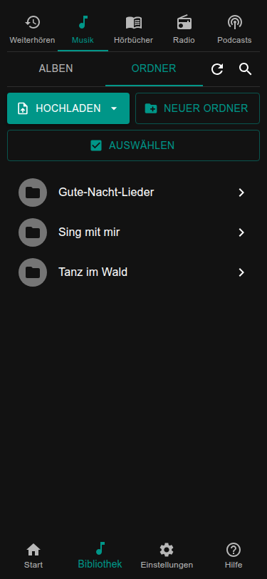
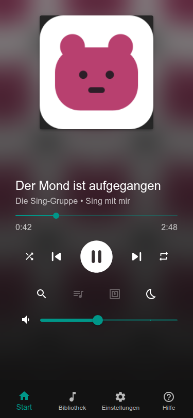

# Die Box läuft: und jetzt?

Die Box spielt. Was sie spielt und wie du es startest, entscheidest du. Karten sind ein Weg, nicht der einzige.

## 1. Auswählen, was gehört werden soll

Such dir eins oder mehrere aus; alles funktioniert nebeneinander.

| Ich möchte | So geht es |
| --- | --- |
| eigene **Musik oder Hörbücher** | Ordner auf der Webseite hochladen (unten). |
| **Radiosender** aus dem Internet | Auf der Webseite hinzufügen: [Radio](../using/radio.md). Dazu braucht es keine Dateien. |
| **Podcasts** | Auf der Webseite suchen und abonnieren: [Podcasts](../using/podcasts.md). |
| Bücher von meinem **Audiobookshelf**-Server | [Hörbücher](../using/audiobooks.md#audiobookshelf). |

### Musik auf die Box bringen

1. Öffne die Webseite der Box: `http://<name>.local`.
2. Öffne **Bibliothek**, dann **Musik** und die Ansicht **Ordner**.
3. Wähle **Hochladen** und such auf deinem Computer einen Ordner mit einem Album aus. Ein Ordner pro Album.

Hörbücher gehen genauso: Bibliothek → **Hörbücher** → Ordner → Hochladen, ein Ordner pro Buch. Die Dateien eines Buchs sind
seine Kapitel und werden in der Reihenfolge ihrer Namen gespielt (`2.mp3` kommt vor `10.mp3`).

Die Bibliothek bemerkt die neuen Dateien nach wenigen Sekunden von selbst. Mehr dazu unter
[Musik und Bibliothek](../using/music.md). Statt hochzuladen kannst du die Dateien auch über das Netzwerk kopieren.

### Abspielen

Tippe auf das Album, das Buch, den Sender oder den Podcast. Der Player auf der **Start**-Seite zeigt, was läuft. Tippe auf
Play und stell die Lautstärke mit dem Regler ein. Hörst du nichts, prüfe, ob die Lautsprecher an sind und die Lautstärke
hoch ist; dann siehe [Ton und Bluetooth](../using/sound.md).

## 2. Auswählen, wie es gestartet wird

| Ich möchte | So geht es |
| --- | --- |
| die **Webseite** auf Handy oder Tablet | Die hast du schon: `http://<name>.local`. Nichts einzurichten. |
| **Karten**, die das Kind auf die Box legt | Braucht einen RFID-Leser: [Deine erste Karte](first-card.md). |
| **Tasten und Drehregler** an der Box | [Tasten und Drehregler](../hardware/buttons.md). |
| einen **Bildschirm** an der Box, der den Player zeigt | [Ein Bildschirm an der Box](../hardware/screen.md). |

Zeitlimits, Bluetooth, eine Ein-Aus-Taste und mehr stehen unter [Was als Nächstes?](../what-next.md).
