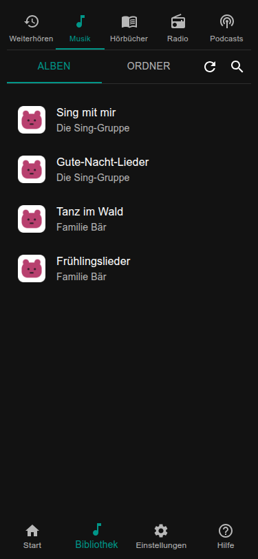

# Musik und Bibliothek

Die Bibliothek ist der Ordner, in dem die Box ihre Musik und Hörbücher aufbewahrt. Im Lauschkiste-Home (`lauschctl home`
zeigt, wo; auf einem Raspberry Pi ist es `~/lauschkiste`) heißt er `library` und enthält zwei Ordner:

```text
library/
├── music/        ein Ordner pro Album
└── audiobooks/   ein Ordner pro Hörbuch
```



## Dateien auf die Box bringen

Egal wie: Jedes Album kommt in einen eigenen Ordner unter `music`, jedes Hörbuch in einen eigenen Ordner unter
`audiobooks`. Die Bibliothek bemerkt neue, geänderte und entfernte Dateien selbst und liest wenige Sekunden nach dem
Kopieren neu ein. Der Aktualisieren-Knopf in der Bibliothek stößt das sofort an.

**Auf der Webseite.** Bibliothek → Ordner → Hochladen: Dateien oder ganze Ordner auswählen, bis 1 GiB pro Datei. Dafür
brauchst du nichts weiter, und es geht auch vom Handy.

**Als Netzwerkordner (Samba).** Magst du lieber deinen Dateimanager, schalte Samba mit `lauschctl setup samba` ein. Die
Box erscheint dann als Netzlaufwerk, das nur die Bibliothek enthält.

- Windows: `\\<name>\lauschkiste`
- macOS: `smb://<name>/lauschkiste` (Finder: Gehe zu, Mit Server verbinden)
- Linux: `smb://<name>/lauschkiste`

Der Benutzername ist der Benutzer, mit dem du dich per SSH anmeldest. Das Passwort ist ein eigenes Samba-Passwort
(mindestens 8 Zeichen); `lauschctl setup samba` fragt danach, und du kannst es auf der Webseite unter
Einstellungen → Bibliothek ändern. Ohne den `lauschctl`-Schritt geht auch `sudo smbpasswd -a <benutzer>`.

## Titelbilder

Die Webseite zeigt das Titelbild eines Albums, wenn sie eins findet. Sie sucht zuerst ein Bild in den Audiodateien, dann
eine Datei `cover.jpg` oder `cover.png` im Albumordner:

```text
library/music/Simone Sommerland/
├── 01 Aramsamsam.mp3
├── 02 Das Rote Pferd.mp3
└── cover.jpg
```

Ein Ordner hat ein Titelbild für alle seine Dateien. Bremsen Titelbilder eine kleine Box aus, schalte sie unter
Einstellungen → Allgemein → *Cover anzeigen* aus.

## Playlists

Ein Album wird in der Reihenfolge seiner Dateien gespielt. Für eine eigene Liste schreibst du eine einfache Textdatei mit
der Endung `.m3u`: ein Dateiname pro Zeile, in der gewünschten Reihenfolge. Leg sie in einen eigenen Ordner:

```text
library/music/Aufwach-Lieder/
└── playlist.m3u
```

```text
# Zeilen mit # am Anfang sind Kommentare
Simone Sommerland/Die 30 besten Kindergartenlieder/08 - Pitsch, patsch, Pinguin.mp3
Bibi und Tina/Soundtrack/07 - Ordinary Girl.mp3
```

Die Pfade gelten ab `library/music`. Der Ordner zeigt dann die Lieder der Liste statt der Datei selbst, und du legst ihn
wie jeden Ordner auf eine Karte. Liegen mehrere `.m3u` in einem Ordner, zählt nur die erste (nach Namen).

Eine Webseite zum Erstellen und Ändern von Playlists ist geplant.

## Wo die Daten liegen

Die Musik liegt in `library`. Der Index, der das Stöbern schnell macht, und die Titelbilder werden bei Bedarf neu
erzeugt; du kannst `settings/library.sqlite` und `cache/covers` löschen, ohne etwas zu verlieren. Karten und Einstellungen
liegen in `settings`, siehe [Einstellungen und Dateien](../maintenance/configuration.md).
