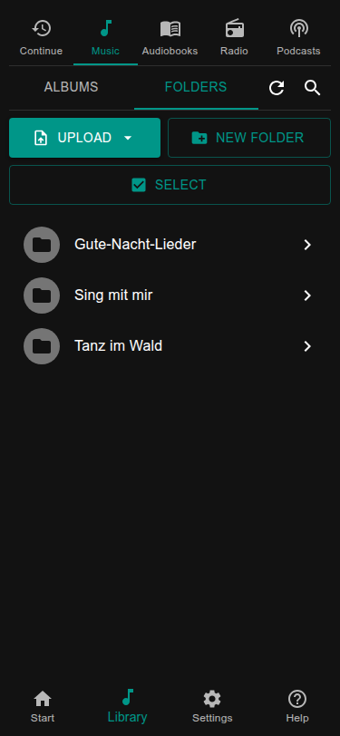
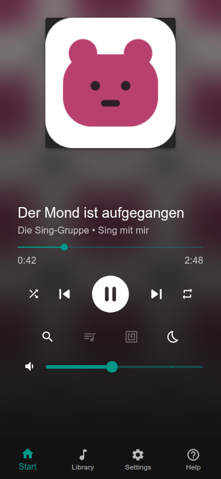

# The box is running: what now?

The box plays. What it plays and how you start it is your choice. Cards are one way, not the only one.

## 1. Choose what to listen to

Pick one or more; all of them work side by side.

| I want | How |
| --- | --- |
| my own **music or audiobooks** | Upload folders in the web page (below). |
| **radio stations** from the internet | Add them in the web page: [Radio](../using/radio.md). No files needed. |
| **podcasts** | Search and subscribe in the web page: [Podcasts](../using/podcasts.md). |
| books from my **Audiobookshelf** server | [Audiobooks](../using/audiobooks.md#audiobookshelf). |

### Put music on the box

1. Open the web page of the box: `http://<name>.local`.
2. Open **Library**, then **Music** and the **Folders** view.
3. Choose **Upload** and pick a folder with an album from your computer. One folder per album.

Audiobooks go the same way: Library → **Audiobooks** → Folders → Upload, one folder per book. The files of a book are
its chapters and play in the order of their names (`2.mp3` comes before `10.mp3`).

The library notices the new files by itself after a few seconds. More about it in [Music and the library](../using/music.md).
You can also copy files over the network instead of uploading them.

### Play it

Tap the album, book, station or podcast. The player on the **Start** page shows what plays. Tap play, change the volume
with the slider. If you hear nothing, check that the speakers are on and the volume is up; then see
[Sound and Bluetooth](../using/sound.md).

## 2. Choose how it is started

| I want | How |
| --- | --- |
| the **web page** on a phone or tablet | You already have it: `http://<name>.local`. Nothing to set up. |
| **cards** the child puts on the box | Needs an RFID reader: [Your first card](first-card.md). |
| **buttons and knobs** on the box | [Buttons and knobs](../hardware/buttons.md). |
| a **screen** on the box that shows the player | [A screen on the box](../hardware/screen.md). |

Time limits, Bluetooth, a power button and more are listed in [What next?](../what-next.md).
