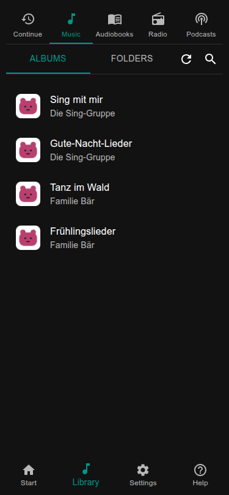

# Music and the library

The library is the folder where the box keeps its music and audiobooks. In the Lauschkiste home (`lauschctl home`
shows where; on a Raspberry Pi it is `~/lauschkiste`) it is `library`, with two folders in it:

```text
library/
├── music/        one folder per album
└── audiobooks/   one folder per audiobook
```



## Getting files onto the box

Whatever you use, each album goes into its own folder below `music` and each audiobook into its own folder below
`audiobooks`. The library notices new, changed and removed files by itself and scans a few seconds after the copying
has finished. The refresh button in the library starts a scan at once.

**In the web page.** Library → Folders → Upload: pick files or whole folders, up to 1 GiB per file. This needs nothing
else and works from a phone too.

**As a network folder (Samba).** If you prefer your file manager, switch on Samba with `lauschctl setup samba`. The box
then shows up as a network drive that holds only the library.

- Windows: `\\<name>\lauschkiste`
- macOS: `smb://<name>/lauschkiste` (Finder: Go, Connect to Server)
- Linux: `smb://<name>/lauschkiste`

The user name is the user you log in with over SSH. The password is a Samba password of its own (at least 8
characters); `lauschctl setup samba` asks for it, and you can change it in the web page under Settings → Library.
Without the `lauschctl` step you can also run `sudo smbpasswd -a <user>`.

## Cover pictures

The web page shows the cover of an album if it finds one. It looks first for a picture inside the audio files, then for
a file `cover.jpg` or `cover.png` in the album folder:

```text
library/music/Simone Sommerland/
├── 01 Aramsamsam.mp3
├── 02 Das Rote Pferd.mp3
└── cover.jpg
```

A folder has one cover for all its files. If covers slow down a small box, switch them off under
Settings → General → *Show cover art*.

## Playlists

An album is played in the order of its files. For a list of your own, write a plain text file with the extension
`.m3u`: one file name per line, in the order you want. Put it into a folder of its own:

```text
library/music/Wake-up songs/
└── playlist.m3u
```

```text
# lines starting with # are comments
Simone Sommerland/Die 30 besten Kindergartenlieder/08 - Pitsch, patsch, Pinguin.mp3
Bibi und Tina/Soundtrack/07 - Ordinary Girl.mp3
```

Paths are relative to `library/music`. The folder then shows the songs of the list instead of the file itself, and you
put it on a card like any folder. If a folder has more than one `.m3u`, only the first (by name) counts.

A web page to create and change playlists is planned.

## Where the data lives

Music is in `library`. The index that makes browsing fast and the cover pictures are made again whenever needed, so
you may delete `settings/library.sqlite` and `cache/covers` without losing anything. Cards and settings are in
`settings`; see [Settings and files](../maintenance/configuration.md).
